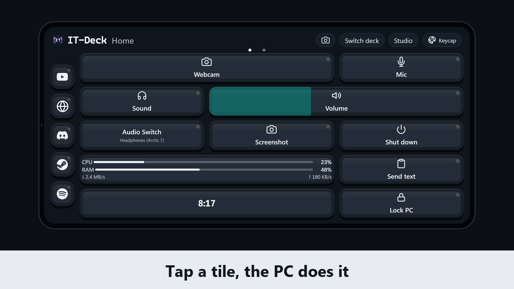
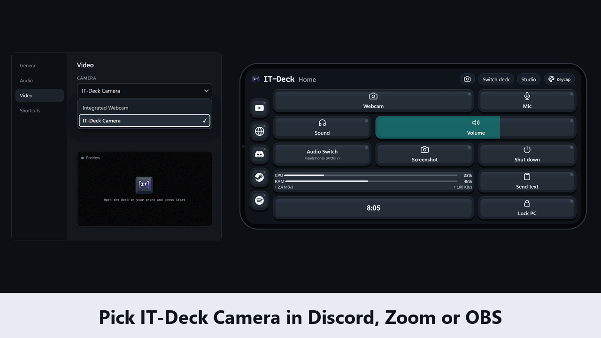
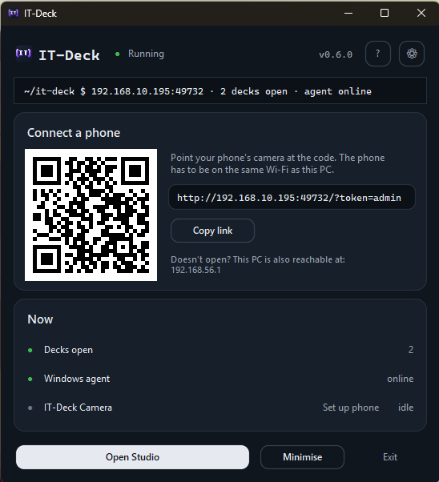

# IT-Deck

<picture>
  <source media="(prefers-color-scheme: dark)" srcset="docs/brand/logo-dark.png">
  
</picture>

An old iPhone becomes a control deck for your Windows PC. One `.exe` on the PC,
a QR code, and the phone is a panel of buttons that also shows what the PC is
doing. The same phone can be your PC's webcam.

**[Русская версия](README.ru.md)**

The same phone is also your PC's webcam in Discord, Zoom and OBS:

You need a Windows PC and a phone on the same Wi-Fi. Nothing else is installed
on either one.

## Set up in 5 minutes

1. **Download `ITDeck.exe`.** Open the
   [Releases page](https://github.com/Itegin/it-deck/releases/latest) and
   download `ITDeck.exe`.
2. **Run it.** Double-click the file. Windows SmartScreen may say "Windows
   protected your PC". The exe is not signed yet, so this is expected. Click
   **More info**, then **Run anyway**.
3. **A window with a QR code opens.** This is the IT-Deck window. The first time,
   a short tour shows you around. Leave the window open.

   

4. **Point the phone's camera at the code.** Use the normal Camera app. Tap the
   banner that appears. The deck opens in your browser.

   

5. **Add it to the Home Screen.** In Safari tap the Share button, then
   **Add to Home Screen**. The deck now has its own icon, like an app.

   

That is all. Tap a tile and the PC does it. The tile shows what happened: the
Mic tile turns red while the microphone is muted.

**Good to know.**
- **Exit** in the window stops IT-Deck. **Minimise** leaves it running.
- Next time start IT-Deck from the **IT-Deck** shortcut it put on your Desktop.
- The VPN tile needs one more step: it has to know which program to launch.
  See *Configuring the VPN tile* under More.

## Your phone as a webcam

The phone's camera becomes a webcam on your PC. Windows 11 only. You set it up
once. After that, apps such as Discord, Zoom and OBS list it as
**IT-Deck Camera**.

1. **Install the camera.** In the IT-Deck window find the Webcam card and press
   **Install camera**. Windows asks for administrator rights. Say yes. This
   happens once.

   

2. **Set up the phone.** Press **Set up phone**. A QR code appears. Scan it with
   the iPhone Camera app. A setup page opens in Safari.

   Why this step? The phone only shares its camera with a page it trusts, so
   you install IT-Deck's certificate (a small trust file) on the phone once.
   The page has four steps with pictures. Do them one by one.

   

3. **Open the deck.** The last step says **Open the deck**. Tap it. On the page
   that opens, tap Share, then **Add to Home Screen**. From now on use this new
   icon. You can delete the old IT-Deck icon.

4. **Pick the camera in your app.** In Discord, Zoom or OBS, open the camera
   settings and choose **IT-Deck Camera**. The picture is a dark placeholder
   for now. That is normal.

   

5. **Tap Start on the phone.** When an app opens the camera, the deck asks
   "An app on the PC wants the camera". Tap **Start**. Your picture appears in
   the app.

   

**Notes.**
- 720p at 30 fps is best over Wi-Fi. 1080p may break up on a weak network.
- The camera stops by itself 15 seconds after the last app closes it.
- A small `[IT-Deck]` mark is always in the corner of the picture.
- The Webcam tile starts or stops the stream with a tap. A long press opens
  the Webcam screen: preview, camera switch, mirror, and **More** for quality,
  frame rate, rotate and stats.
- In Discord and Zoom your own preview looks mirrored. Other people see the
  picture the right way round.
- Android may work through Chrome (the setup page has the steps), but it has
  not been tested on real phones yet.

## Make it yours in Studio

Studio is where you build the deck. Press **Open Studio** in the IT-Deck window.
It opens in the PC's browser. On the left is a live preview of the deck. Click a
tile to edit it, press `+` to add one, drag to move. You choose what a tile
does from cards, with no commands to type. The **Guide** button in the top bar
is a short illustrated how-to.

Pick a look from five tile themes: Flat, Pastel, Glossy, Liquid Glass and
Keycap. Each works on a dark or a light background. Tap the pill in the deck's
header to switch theme.

## If something doesn't work

| What you see | What to do |
| --- | --- |
| The QR code or link doesn't open on the phone | Check that the phone is on the same Wi-Fi. Try the other addresses the window lists under the link; a PC with a VPN has several |
| No address works | Windows Firewall: a cancelled prompt leaves **Block** rules for `itdeck.exe`. Delete them in the inbound rules, or make the network Private |
| IT-Deck Camera isn't in the app's list | Press **Install camera** in the Webcam card, then restart the app. Windows 11 only |
| The app shows a placeholder, not your picture | Open the deck on the phone and tap **Start**. Use the Home Screen icon you added during **Set up phone** |
| The phone won't give the camera to the page | The certificate isn't trusted yet. Run **Set up phone** again and finish all the steps |
| The picture breaks up | On the Webcam screen open **More** and choose 720p at 30 fps. Check the Wi-Fi |
| A tile does nothing, or the deck turns into a clock | The PC side has stopped. Press **Start the agent** in the IT-Deck window (needed after the **Close Agent** tile). After a crash it restarts itself |
| The VPN tile does nothing | It has no path yet. See *Configuring the VPN tile* under More |
| The phone asks for a token | The token changed. Type the new one, or scan the QR code again |
| IT-Deck says the port is already in use | Another copy is running. Exit it from its window, or end `ITDeck.exe` in Task Manager |
| A change doesn't show on the phone | Pull down to reload, or close and reopen the Home Screen icon |
| Nothing starts at all | Read `%LOCALAPPDATA%\IT-Deck\logs\backend.log` |

## More

Everything below is optional.

What is new in 0.6.0

- **The phone as a webcam** on Windows 11: IT-Deck Camera shows up in
  Discord, Zoom and OBS like any webcam.
- **Graphite look.** A calm, business palette across the phone, Studio and
  the PC window, dark or light to match Windows. New `[IT-Deck]` logo.
- **A new Keycap tile theme.**
- **A new PC window.** It opens on what is happening now: open decks, the
  Windows agent, the camera. Rare actions moved into **Settings**.

What the first launch does, and what you need

On first launch IT-Deck puts an **IT-Deck** shortcut on your Desktop (use that
from then on), generates `%LOCALAPPDATA%\IT-Deck\config.env` with two tokens
(both `admin` by default) and a port (`49732`, or the next free one), and
starts the backend and the Windows agent as separate processes. There is no
console: the logs are in `%LOCALAPPDATA%\IT-Deck\logs\`. Config and tokens
survive restarts. Deleting `config.env` or changing the port invalidates the
link your phone already has, so open the newly shown one once afterwards.

Anything IT-Deck launched for you, your VPN client included, keeps running
after you press **Exit**.

**You need** a Windows PC to control (the agent uses Windows COM audio APIs
and runs in the interactive user session) and a phone with a browser on the
same LAN. The webcam needs Windows 11. No server, no Docker, no Python.

The tiles

Tapping a tile sends a command over a WebSocket to the Windows agent, which
runs it and reports back. Every command resolves within 5 seconds (ok, error
or timeout) and the tile shows which. Long-press opens a menu with **Force
Stop** for a stuck process.

A fresh install seeds eight, all wired to something real:

| Tile | What it does |
| --- | --- |
| **Terminal** | Launches an app: Windows Terminal by default |
| **Mic** | Mutes/unmutes the microphone; red while muted |
| **Volume** | Drag to set the system output volume |
| **Headphones** | Mutes/unmutes speaker output |
| **Audio Switch** | Swaps between two output devices, naming the current one |
| **Screenshot** | Captures the primary monitor to the **PC's** clipboard |
| **VPN** | Launches your VPN client, lit while it runs; **needs a path first** |
| **Close Agent** | Stops the agent; **Start the agent** in the IT-Deck window brings it back |

Studio adds more:

| Tile | What it does |
| --- | --- |
| **Webcam** | Tap starts or stops the phone's camera stream; long press opens the Webcam screen |
| **Clock & weather** | The phone's own time and date, plus the weather for a city you pick (Open-Meteo, no API key) |
| **PC load** | Live CPU and memory bars and network speed |
| **Hotkey** | Presses a key combination on the PC, e.g. `ctrl+shift+m` to mute in Discord |
| **Media key** | Play/pause, next, previous, stop, volume up or down |
| **Power** | Lock, sleep, shut down or restart; asks before it acts |
| **Send text** | Type on the phone, paste on the PC: the text lands on its clipboard |
| **Program on/off** | Starts a program, or closes it if it is already running |

Any tile can be set to **Ask before running**: the phone then shows Run /
Cancel first. Some games and anti-cheat systems ignore simulated key presses,
so a Hotkey tile may do nothing inside them.

**Quick launch.** **Open a website** opens any address in the PC's browser
(one-tap presets for Telegram Web, Discord, YouTube, ChatGPT and more), and
**Open an app** picks a program straight from the PC's Start Menu. They go to
the **quick-launch bar**: up to seven square buttons along the bottom of an
upright phone, or down the left side of a sideways one. Icons can be a
symbol, a logo, a few letters or the site's own icon. The logos cover popular
services and games and launchers: Steam, Epic Games, Battle.net, EA,
Ubisoft, GOG, Valorant, League of Legends, Counter-Strike, Dota 2, PUBG,
Fortnite, Roblox and more. An installed game picks up its logo by itself.

**Several decks.** With more than one deck, swipe sideways on the phone to
move between them; the dots under the header show where you are and switch
with a tap. Studio's **Decks** dialog reorders, renames, downloads and
deletes them, adds new ones, and can turn swiping off.

When the PC end goes away (the agent closed, or IT-Deck itself), every tile
becomes a button that can't do anything, so the clock widget takes the whole
screen as a seven-segment clock and keeps showing the time until the PC comes
back. The deck restores itself; there is nothing to switch.

The look is two settings: the **theme** (Flat, Pastel, Glossy, Liquid Glass,
Keycap), cycled from the pill in the deck's header, and the **background**
(auto, light or dark), set in Studio. Both sync to every connected phone.
The PC window and Studio follow Windows, dark or light.

Studio in detail

`/studio.html` on the PC: the **Open Studio** button in the window. A live
preview of the deck on the left, an editor on the right: audio devices come
from the list the agent reports, programs come from **Choose from installed
programs** (Start Menu and Microsoft Store apps), **Where** puts a button in
the grid or the quick-launch bar, and **Compact layout** closes the gaps.
English or Russian, following the browser. The phone never edits the catalog.
**Guide** opens by itself the first time.

The rest of the top bar:
- **Decks** saves the deck on screen to a file, adds a deck from a file, or
  starts one from a template (**Streamer**, **Work**). A file always becomes
  a *new* deck and never changes the one you have. Open only files you
  trust: a tile can start programs on the PC.
- **Access** shows and changes the two tokens (see below).
- **What's new** lists the latest changes. A dot marks it until you have read
  them.

Tokens and PIN

There are two: the **Phone token** (what the phone sends) and the **Agent
token** (what the Windows agent sends). Both are `admin` out of the box, which
is fine on your own Wi-Fi. If you share the network, change them:
- **Settings → New phone token** in the IT-Deck window makes a random 6-digit
  phone token. The QR code updates, and phones on the old token ask for the
  new one once. **Show agent token** is in the same card.
- **Studio → Access** changes either token by hand, or makes a random PIN.
  The change applies at once, with no restart.

Configuring the VPN tile

Until a path is set, a **Set the path to your VPN client** card sits at the
top of Studio. Paste the full path to the client's `.exe` and press **Save**.
The quickest way to get it is to select the file in Explorer and press
**Ctrl+Shift+C**, quotes and all; Studio strips them.

The tile then lights up whenever that program runs, including before you ever
press it. Pressing it **starts** the VPN; to stop one, long-press and use
**Force Stop**.

**If the tile reports that the program runs as administrator**, that is the
usual reason a VPN tile looks dead: Windows puts a UAC prompt on the PC and
you are holding a phone. Either clear **Run this program as an administrator**
in the exe's Properties → Compatibility, or run `ITDeck.exe` as administrator.

**One tile that toggles it on and off.** In the VPN tile's editor press
**Change type**, pick **Program on/off**, and fill in the process name (e.g.
`v2RayTun.exe`) and the path to the exe. One press then starts it and the next
stops it, with no confirmation step, which is why it isn't the default.

Easy on games

IT-Deck is meant to sit next to a game without costing frames. While no phone
has the deck open, the agent stops reading audio and process state
altogether. The backend and the agent's own work run at below-normal
priority, so a busy CPU goes to the game first; programs IT-Deck launches keep
normal priority. The VPN check remembers the process instead of scanning the
process list every second. Measured cost while a phone *is* open: about
0.1 ms of work per second.

The webcam follows the same rule. Nothing runs while the camera is off, and
it works fine while a game runs.

**Start IT-Deck with Windows** (in Settings, off by default) starts it at
sign-in.

Updates

The window checks the releases page once at startup and shows a **Download**
button if a newer version exists. One request, nothing about you is sent, and
any failure is ignored silently. Turn it off with `UPDATE_CHECK=0` in
`config.env`. Only the exe can be out of date: the phone loads the deck from
whatever version is running. If the camera driver is older than the one in
the new exe, the Webcam card shows **Update camera**; Windows asks for
administrator rights once more.

**Your settings survive updates.** Tiles, decks, tokens and the port live in
`%LOCALAPPDATA%\IT-Deck`, not in the exe: replace the exe and everything is
still there. After an update the window shows a short **What's new** card
once.

Removing IT-Deck

**Settings** in the window has a quiet **Remove IT-Deck from this PC**
button. It deletes the exe, the Desktop shortcut, your settings, tokens and
tile layout, its Windows Firewall rules, and the temp directory the exe
unpacks into, which is everything IT-Deck ever writes. Deleting the exe on
its own leaves the other four behind.

It asks first, in a window listing what will go; Cancel holds the focus, so
Enter or Escape closes it without deleting anything. Windows asks for
permission once, only to remove the firewall rules; refusing that still
removes everything else. The home-screen icon on your phone stays; remove
that one on the phone.

Uninstall also removes IT-Deck Camera first (Windows asks for administrator
rights for that). If you only delete the exe, the camera stays in Windows:
press **Remove camera** in Settings before you do.

## Status

A personal project in active development. The latest version is on the [Releases page](https://github.com/Itegin/it-deck/releases/latest); what changed is in [CHANGELOG.md](CHANGELOG.md).

## License

Free for personal and other non-commercial use under the
[PolyForm Noncommercial License 1.0.0](LICENSE): use it and share it.
IT-Deck is free today. Commercial use only by agreement with the author:
[get in touch](https://github.com/Itegin).

**The source code is not public**: IT-Deck is published as a ready-to-run
exe. The name IT-Deck and its logo identify this project and its author, and
official builds come only from this repository's
[releases](https://github.com/Itegin/it-deck/releases); see
[`NOTICE`](NOTICE). Found a bug or have an idea?
[Open an issue](https://github.com/Itegin/it-deck/issues).

What IT-Deck bundles or talks to (Python packages, NirSoft SoundVolumeView,
Open-Meteo, the Simple Icons logos) is listed with its terms in
[`THIRD-PARTY-NOTICES.md`](THIRD-PARTY-NOTICES.md). Brand logos are their
owners' trademarks, used only to show which app a tile opens.
