# IT-Deck

<picture>
  <source media="(prefers-color-scheme: dark)" srcset="docs/brand/logo-dark.png">
  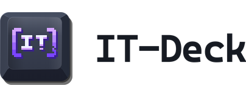
</picture>

Старый iPhone становится пультом для Windows-ПК. Один `.exe` на компьютере,
QR-код — и телефон работает как панель кнопок, которая ещё и показывает, что
делает ПК. Тот же телефон может стать веб-камерой для ПК.

**[English version](README.md)**

Нужны Windows-ПК и телефон в той же сети Wi-Fi. Больше ничего ставить не надо.

## Настройка за 5 минут

1. **Скачай `ITDeck.exe`.** Открой
   [страницу релизов](https://github.com/Itegin/it-deck/releases/latest) и
   скачай `ITDeck.exe`.
2. **Запусти его.** Дважды щёлкни по файлу. Windows SmartScreen может написать
   «Windows защитила ваш компьютер». Exe пока не подписан, так что это
   ожидаемо. Нажми **«Подробнее»**, затем **«Выполнить в любом случае»**.
3. **Откроется окно с QR-кодом.** Это окно IT-Deck. В первый раз короткое
   обучение покажет, что где. Не закрывай окно.

   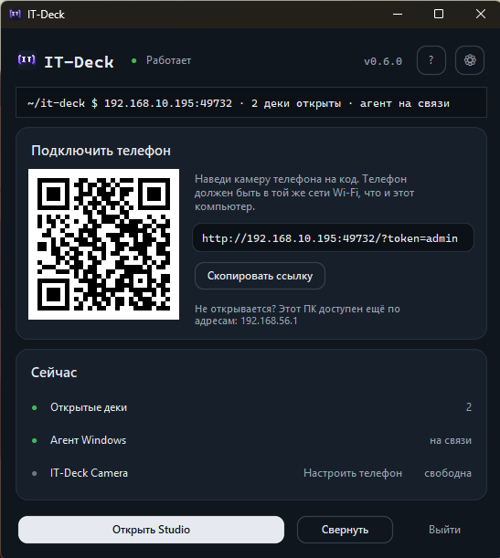

4. **Наведи камеру телефона на код.** Подойдёт обычное приложение «Камера».
   Нажми на появившуюся плашку. Дека откроется в браузере.

   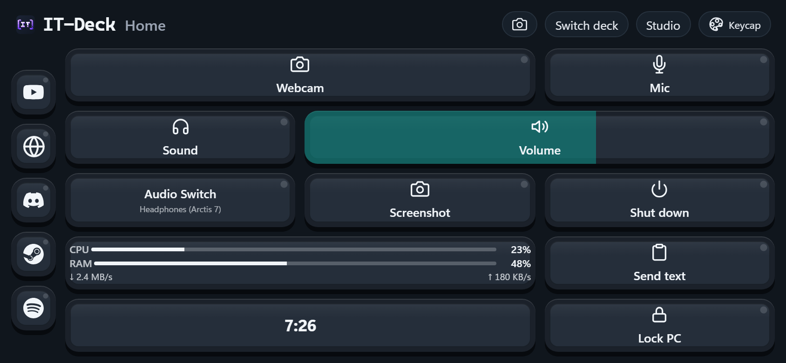

5. **Добавь деку на экран «Домой».** В Safari нажми «Поделиться», затем
   **«На экран „Домой“»**. У деки появится своя иконка, как у приложения.

   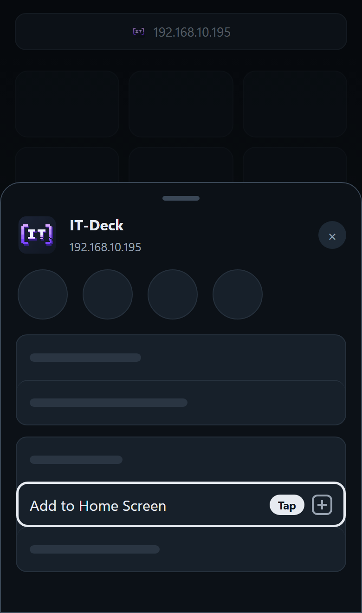

Это всё. Нажми плитку, и ПК выполнит команду. Плитка покажет, что вышло:
плитка Mic краснеет, пока микрофон выключен.

**Полезно знать.**
- **«Выйти»** в окне останавливает IT-Deck. **«Свернуть»** оставляет его
  работать.
- В следующий раз запускай IT-Deck с ярлыка **IT-Deck** на рабочем столе — он
  его создал.
- Плитке VPN нужен ещё один шаг: ей надо указать, какую программу запускать.
  См. «Настройка плитки VPN» в разделе «Ещё».

## Телефон как веб-камера

Камера телефона становится веб-камерой на ПК. Только Windows 11. Настроить
нужно один раз. Потом приложения вроде Discord, Zoom и OBS покажут её как
**IT-Deck Camera**.

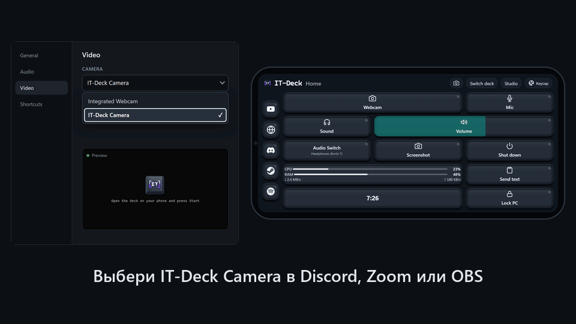

1. **Установи камеру.** В окне IT-Deck найди карточку веб-камеры и нажми
   **«Установить камеру»**. Windows спросит права администратора. Согласись.
   Это бывает один раз.

   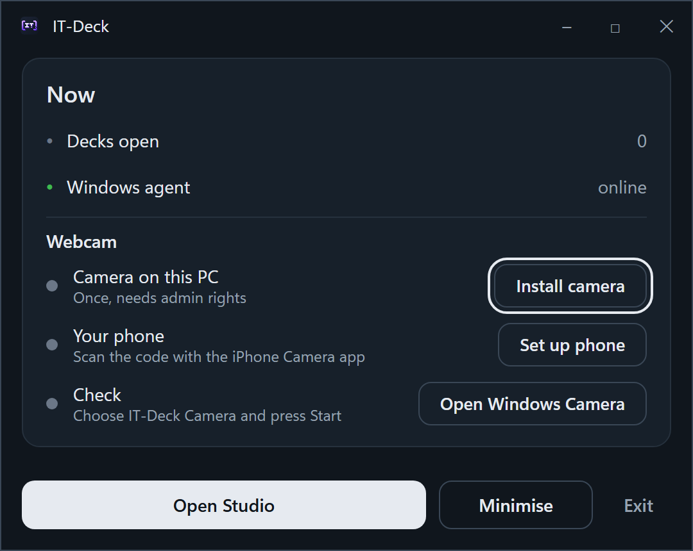

2. **Настрой телефон.** Нажми **«Настроить телефон»**. Появится QR-код.
   Отсканируй его камерой iPhone. В Safari откроется страница настройки.

   Зачем этот шаг? Телефон даёт камеру только странице, которой доверяет, так
   что сертификат IT-Deck (небольшой файл доверия) нужно один раз поставить на
   телефон. На странице четыре шага с картинками. Проходи их по очереди.

   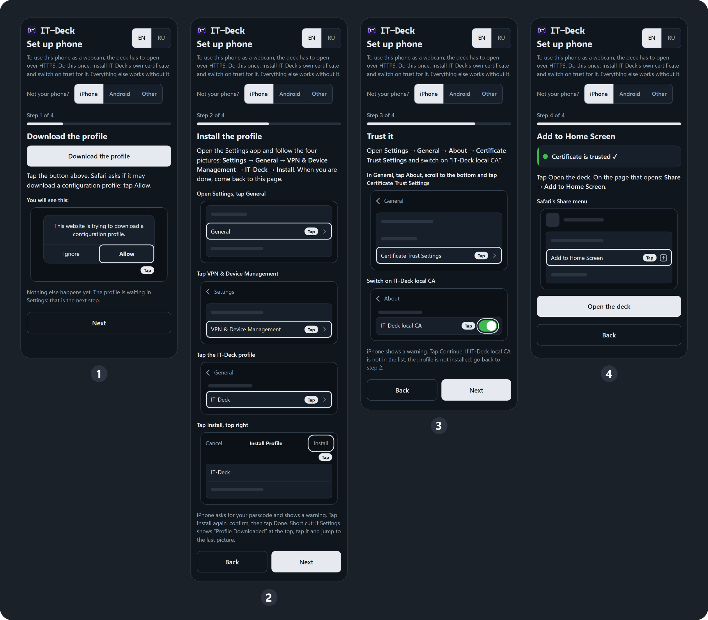

3. **Открой деку.** На последнем шаге есть кнопка **«Открыть деку»**. Нажми её.
   На открывшейся странице нажми «Поделиться», затем **«На экран „Домой“»**.
   Дальше пользуйся этой новой иконкой. Старую иконку IT-Deck можно удалить.

4. **Выбери камеру в приложении.** В Discord, Zoom или OBS открой настройки
   камеры и выбери **IT-Deck Camera**. Пока там тёмная заставка. Так и должно
   быть.

   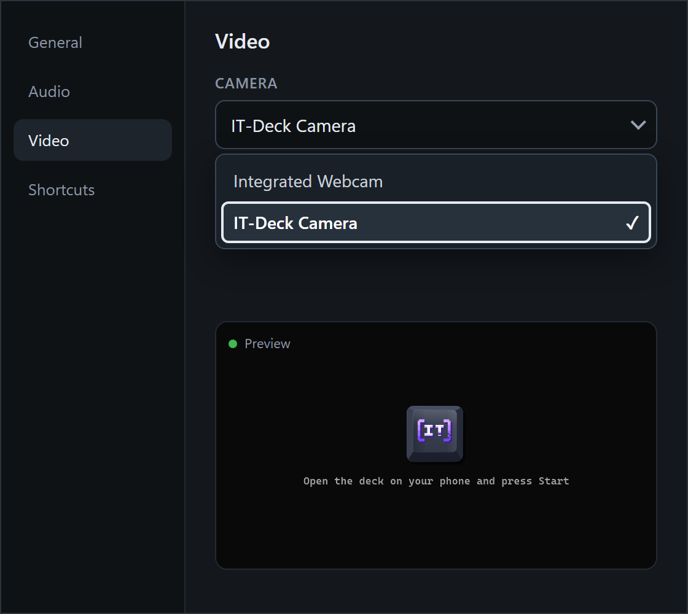

5. **Нажми Start на телефоне.** Когда приложение открывает камеру, дека
   спрашивает «An app on the PC wants the camera». Нажми **Start**. В
   приложении появится твоя картинка.

   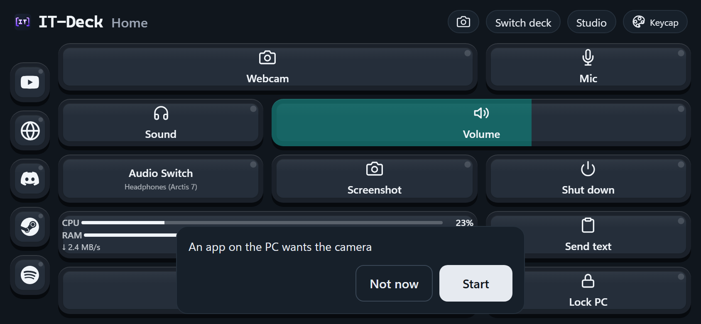

**Заметки.**
- По Wi-Fi лучше всего 720p при 30 кадрах в секунду. 1080p может рваться в
  слабой сети.
- Камера останавливается сама через 15 секунд после того, как последнее
  приложение её закрыло.
- Метка `[IT-Deck]` всегда в углу картинки.
- Плитка Webcam запускает и останавливает поток нажатием. Долгое нажатие
  открывает экран веб-камеры: предпросмотр, смена камеры, зеркало и **More** —
  качество, частота кадров, поворот и статистика.
- В Discord и Zoom твоё превью выглядит зеркальным. Собеседники видят кадр
  в правильную сторону.
- Android, возможно, заработает через Chrome (шаги есть на странице
  настройки), но на настоящих телефонах это пока не проверяли.

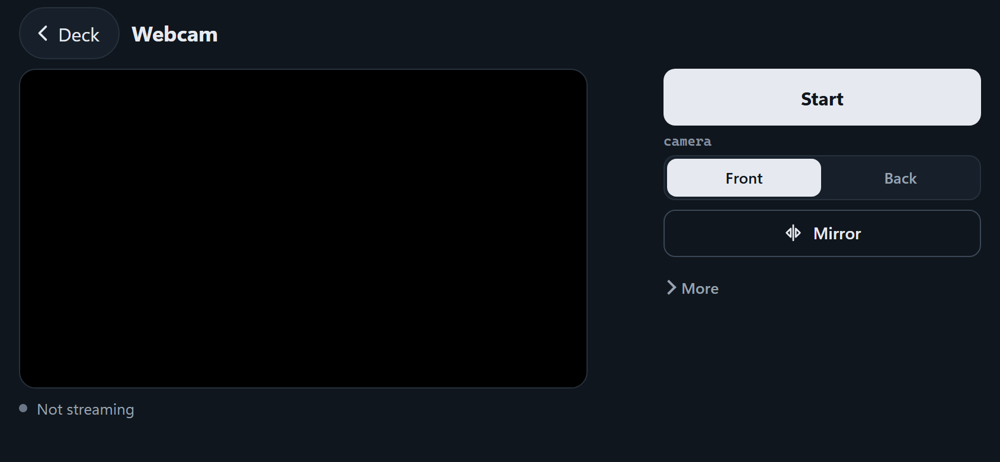

## Настрой деку под себя в Studio

Studio — место, где дека собирается. Нажми **«Открыть Studio»** в окне
IT-Deck. Она откроется в браузере на ПК. Слева живой предпросмотр деки. Клик по
плитке открывает её настройки, `+` добавляет новую, перетаскивание двигает.
Что делает плитка, выбираешь карточками, команды набирать не надо. Кнопка
**«Гайд»** в верхней панели — короткая инструкция с картинками.

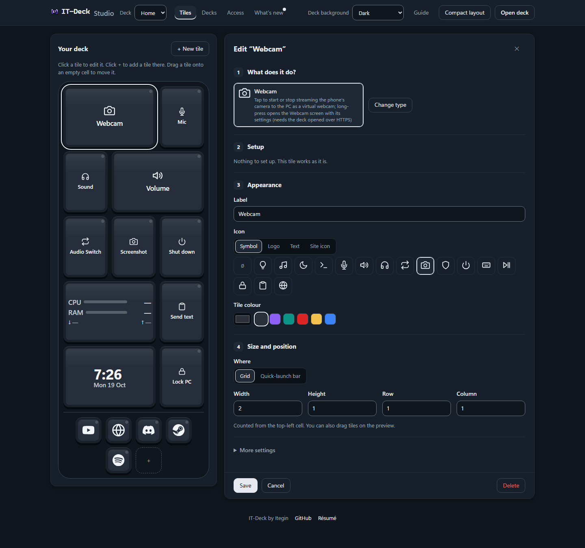

Выбери вид из пяти тем плиток: Flat, Pastel, Glossy, Liquid Glass и Keycap.
Каждая работает на тёмном и светлом фоне. Тема переключается «таблеткой» в
шапке деки.

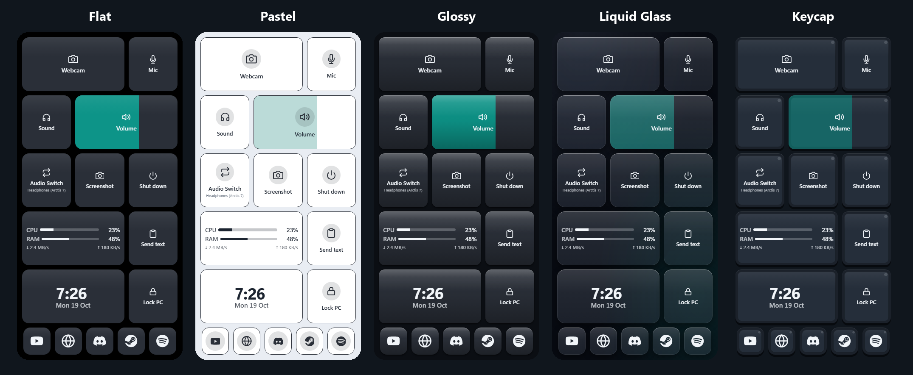

## Если что-то не работает

| Что видишь | Что делать |
| --- | --- |
| QR-код или ссылка не открываются на телефоне | Проверь, что телефон в той же сети Wi-Fi. Попробуй другие адреса, которые окно перечисляет под ссылкой — у ПК с VPN их несколько |
| Не работает ни один адрес | Брандмауэр Windows: отменённый запрос оставляет правила **«Блокировать»** для `itdeck.exe`. Удали их во входящих правилах или сделай сеть частной |
| IT-Deck Camera нет в списке камер приложения | Нажми **«Установить камеру»** в карточке веб-камеры и перезапусти приложение. Только Windows 11 |
| Приложение показывает заставку вместо картинки | Открой деку на телефоне и нажми **Start**. Пользуйся иконкой, которую добавил при **«Настроить телефон»** |
| Телефон не отдаёт камеру странице | Сертификату ещё не доверяют. Запусти **«Настроить телефон»** снова и пройди все шаги |
| Картинка рвётся | На экране Webcam открой **More** и поставь 720p при 30 кадрах в секунду. Проверь Wi-Fi |
| Плитка ничего не делает или дека превратилась в часы | Остановилась часть на ПК. Нажми **«Запустить агент»** в окне IT-Deck (это нужно после плитки **Close Agent**). После сбоя она перезапускается сама |
| Плитка VPN ничего не делает | У неё ещё нет пути. См. «Настройка плитки VPN» в разделе «Ещё» |
| Телефон просит токен | Токен сменился. Введи новый или отсканируй QR-код заново |
| IT-Deck пишет, что порт уже занят | Уже запущена другая копия. Закрой её кнопкой «Выйти» или заверши `ITDeck.exe` в диспетчере задач |
| Изменение не видно на телефоне | Потяни страницу вниз, чтобы обновить, или закрой и снова открой иконку |
| Вообще ничего не стартует | Загляни в `%LOCALAPPDATA%\IT-Deck\logs\backend.log` |

## Ещё

Всё ниже необязательно.

Что нового в 0.6.0

- **Телефон как веб-камера** на Windows 11: IT-Deck Camera появляется в
  Discord, Zoom и OBS, как обычная веб-камера.
- **Стиль Graphite.** Спокойная деловая палитра на телефоне, в Studio и в окне
  на ПК, тёмная или светлая — как в Windows. Новый логотип `[IT-Deck]`.
- **Новая тема плиток Keycap.**
- **Новое окно на ПК.** Оно открывается с того, что происходит сейчас: открытые
  деки, Windows-агент, камера. Редкие действия переехали в **«Настройки»**.

Что делает первый запуск и что нужно

При первом запуске IT-Deck кладёт ярлык **IT-Deck** на рабочий стол (дальше
запускай с него), создаёт `%LOCALAPPDATA%\IT-Deck\config.env` с двумя токенами
(по умолчанию оба `admin`) и портом (`49732` или следующий свободный) и
поднимает бэкенд и Windows-агент отдельными процессами. Консоли нет — логи
лежат в `%LOCALAPPDATA%\IT-Deck\logs\`. Конфиг и токены переживают
перезапуски: если удалить `config.env` или сменить порт, ссылка, сохранённая
на телефоне, перестанет работать — тогда открой на нём новую один раз.

Всё, что IT-Deck запустил по твоей команде (включая VPN-клиент), продолжает
работать после «Выйти».

**Что нужно:** Windows-ПК для управления (агент использует COM-API звука
Windows и работает в интерактивном сеансе пользователя) и телефон с браузером
в той же локальной сети. Для веб-камеры нужна Windows 11. Ни сервера, ни
Docker, ни Python.

Плитки

Нажатие отправляет команду по WebSocket Windows-агенту, тот её выполняет и
отвечает. Любая команда завершается за 5 секунд — успех, ошибка или таймаут, —
и плитка показывает, чем именно. Долгое нажатие открывает меню с **Force
Stop** для зависшего процесса.

Свежая установка создаёт восемь плиток, и за каждой стоит реальная команда:

| Плитка | Что делает |
| --- | --- |
| **Terminal** | Запускает приложение — по умолчанию Windows Terminal |
| **Mic** | Включает/выключает микрофон; красная во время мьюта |
| **Volume** | Перетаскиванием задаёт громкость вывода |
| **Headphones** | Включает/выключает звук динамиков |
| **Audio Switch** | Переключает два устройства вывода и называет текущее |
| **Screenshot** | Снимает главный монитор в буфер обмена **ПК** |
| **VPN** | Запускает VPN-клиент, подсвечена, пока он работает — **сначала нужен путь** |
| **Close Agent** | Останавливает агент; вернуть — кнопкой **«Запустить агент»** в окне IT-Deck |

В Studio есть и другие:

| Плитка | Что делает |
| --- | --- |
| **Webcam** | Нажатие запускает или останавливает поток с камеры телефона; долгое нажатие открывает экран Webcam |
| **Время и погода** | Собственные часы и дата телефона плюс погода для выбранного города (Open-Meteo, без API-ключа) |
| **Нагрузка ПК** | Живые полоски загрузки процессора и памяти, скорость сети |
| **Горячие клавиши** | Нажимает сочетание клавиш на ПК, например `ctrl+shift+m` — выключить микрофон в Discord |
| **Медиаклавиша** | Пауза/воспроизведение, следующий и предыдущий трек, стоп, громкость |
| **Питание** | Блокировка, сон, выключение или перезагрузка; сначала спрашивает |
| **Отправить текст** | Набираешь на телефоне, вставляешь на ПК: текст попадает в его буфер обмена |
| **Вкл/выкл программу** | Запускает программу или закрывает её, если та уже работает |

Любой плитке можно включить **«Спрашивать перед запуском»** — тогда телефон
сначала покажет «Запустить / Отмена». Некоторые игры и античиты игнорируют
программные нажатия клавиш, поэтому внутри них плитка горячих клавиш может
не сработать.

**Быстрый запуск.** **«Открыть сайт»** открывает любой адрес в браузере ПК
(готовые пресеты: Telegram Web, Discord, YouTube, ChatGPT и другие), а
**«Открыть программу»** выбирает программу прямо из меню «Пуск» на ПК. Такие
кнопки попадают в **панель быстрого запуска**: до семи квадратных кнопок внизу,
когда телефон стоит вертикально, и слева, когда лежит горизонтально. Значок —
символ, логотип, пара букв или иконка самого сайта. Среди логотипов — популярные
сервисы, а также игры и лаунчеры: Steam, Epic Games, Battle.net, EA, Ubisoft,
GOG, Valorant, League of Legends, Counter-Strike, Dota 2, PUBG, Fortnite,
Roblox и другие. Установленная игра получает свой логотип сама.

**Несколько дек.** Если дек больше одной, листай их свайпом вбок на телефоне;
точки под шапкой показывают, где ты, и переключают по нажатию. В Studio
в окне **«Деки»** их можно переставить, переименовать, скачать и удалить,
добавить новые и выключить переключение свайпом.

Когда ПК-сторона отваливается — закрыт агент или сам IT-Deck, — каждая плитка
превращается в кнопку, которая ничего не может, поэтому виджет часов занимает
весь экран в виде семисегментных часов и продолжает показывать время, пока ПК
не вернётся. Дека восстанавливается сама, переключать ничего не нужно.

Внешний вид — это две настройки: **тема** (Flat, Pastel, Glossy, Liquid Glass,
Keycap) переключается «таблеткой» в шапке деки, **фон** (авто, светлый,
тёмный) задаётся в Studio. Обе синхронизируются на все подключённые телефоны.
Окно на ПК и Studio следуют теме Windows, тёмной или светлой.

Studio подробнее

`/studio.html` на ПК — кнопка **«Открыть Studio»** в окне. Слева живой
предпросмотр деки, справа редактор: устройства звука подставляются из списка,
который сообщает агент; программы — через **«Выбрать из установленных
программ»** (меню «Пуск» и приложения Microsoft Store); **«Где»** ставит кнопку
в сетку или в панель быстрого запуска; **компактная раскладка** убирает дыры
в сетке. Язык — английский или русский, по языку браузера. С телефона каталог
не меняется. **«Гайд»** в первый раз открывается сам.

Остальное в верхней панели:
- **«Деки»** — сохранить деку на экране в файл, добавить деку из файла или
  начать с шаблона (**«Стример»**, **«Работа»**). Файл всегда становится
  *новой* декой и не меняет существующую. Открывай только файлы, которым
  доверяешь: плитка может запускать программы на ПК.
- **«Доступ»** — посмотреть и сменить оба токена (см. ниже).
- **«Что нового»** — последние изменения; точка горит, пока не прочитаешь.

Токены и PIN

Их два: **токен телефона** (его присылает телефон) и **токен агента** (его
присылает Windows-агент). Оба по умолчанию `admin` — для своего Wi-Fi этого
достаточно. Если сеть общая, смени их:
- **«Настройки» → «Новый токен телефона»** в окне IT-Deck создаёт случайный
  6-значный токен телефона. QR-код обновляется, а телефоны со старым токеном
  один раз спросят новый. **«Показать токен агента»** лежит в той же карточке.
- **Studio → «Доступ»** меняет любой из токенов вручную или создаёт случайный
  PIN. Изменение применяется сразу, без перезапуска.

Настройка плитки VPN

Пока путь не задан, наверху Studio висит карточка **«Укажи путь до
VPN-клиента»**. Вставь полный путь до `.exe` и нажми **«Сохранить»**. Быстрее
всего получить его так: выдели файл в проводнике и нажми **Ctrl+Shift+C** —
кавычки, которые он добавляет, Studio уберёт сама.

После этого плитка подсвечивается всегда, когда программа запущена, — в том
числе до первого нажатия. Нажатие **запускает** VPN; чтобы остановить, зажми
плитку и выбери **Force Stop**.

**Если плитка сообщает, что программа запускается от администратора** — это
самая частая причина «мёртвой» плитки VPN: Windows показывает запрос UAC на
ПК, а у тебя в руках телефон. Либо сними галку **«Запускать эту программу от
имени администратора»** в свойствах exe → «Совместимость», либо запускай сам
`ITDeck.exe` от администратора.

**Одна плитка-переключатель.** В редакторе плитки VPN нажми **«Сменить тип»**,
выбери **«Программа вкл/выкл»** и укажи имя процесса (например,
`v2RayTun.exe`) и путь до exe. Тогда одно нажатие запускает, следующее —
останавливает. Подтверждения нет, поэтому по умолчанию не так.

Бережно к играм

IT-Deck задуман так, чтобы работать рядом с игрой и не отнимать FPS. Пока ни
один телефон не открыл деку, агент вообще не опрашивает звук и процессы.
Бэкенд и собственная работа агента идут с пониженным приоритетом, так что
занятый процессор в первую очередь достаётся игре; программы, которые
запускает IT-Deck, получают обычный приоритет. Проверка VPN запоминает процесс,
а не перебирает список процессов каждую секунду. Замеренная стоимость, пока
телефон *открыт*: около 0,1 мс работы в секунду.

С веб-камерой то же правило. Пока камера выключена, ничего не работает, а
когда она включена, это не мешает игре.

**«Запускать IT-Deck вместе с Windows»** (в «Настройках», по умолчанию
выключено) запускает его при входе в систему.

Обновления

Окно один раз при запуске проверяет страницу релизов и показывает кнопку
**«Скачать»**, если вышла новая версия. Это один запрос, ничего о тебе не
отправляется, любая ошибка молча игнорируется. Выключается через
`UPDATE_CHECK=0` в `config.env`. Устареть может только exe — телефон каждый
раз загружает деку из той версии, которая запущена. Если драйвер камеры старее
того, что в новом exe, в карточке веб-камеры появится **«Обновить камеру»**;
Windows ещё раз спросит права администратора.

**Настройки переживают обновления.** Плитки, деки, токены и порт хранятся в
`%LOCALAPPDATA%\IT-Deck`, а не в exe: заменил exe — всё на месте. После
обновления окно один раз показывает короткую карточку **«Что нового»**.

Как удалить IT-Deck

В **«Настройках»** окна есть неприметная кнопка **«Удалить IT-Deck с этого
ПК»**. Она удаляет сам exe, ярлык с рабочего стола, настройки, токены и
раскладку плиток, правила брандмауэра Windows и временный каталог, в который
exe распаковывается, — это всё, что IT-Deck вообще пишет на диск. Если удалить
только exe, остальные четыре следа останутся.

Сначала он спросит — в окне со списком того, что исчезнет; фокус стоит на
«Отмена», так что Enter и Escape просто закрывают его. Windows один раз
спросит разрешение — оно нужно только для правил брандмауэра, и если
отказаться, всё остальное всё равно удалится. Иконка на домашнем экране
телефона останется — её удали на телефоне.

Удаление сначала убирает и IT-Deck Camera (для этого Windows спросит права
администратора). Если просто удалить exe, камера останется в Windows: перед
этим нажми **«Удалить камеру»** в «Настройках».

## Статус

v0.6.0 — личный проект, активная разработка, API может меняться.

## Лицензия

Бесплатно для личного и другого некоммерческого использования по
[PolyForm Noncommercial License 1.0.0](LICENSE): пользуйтесь и делитесь.
Сейчас IT-Deck бесплатен. Коммерческое использование — только по
договорённости с автором: [напишите мне](https://github.com/Itegin).

**Исходный код закрыт**: IT-Deck распространяется готовым exe. Название
IT-Deck и логотип обозначают этот проект и его автора, а официальные сборки
выходят только в [релизах](https://github.com/Itegin/it-deck/releases) этого
репозитория — см. [`NOTICE`](NOTICE). Нашли ошибку или есть идея?
[Создайте issue](https://github.com/Itegin/it-deck/issues).

Что IT-Deck включает в себя или с чем работает (пакеты Python, NirSoft
SoundVolumeView, Open-Meteo, логотипы Simple Icons), перечислено вместе с
условиями в [`THIRD-PARTY-NOTICES.md`](THIRD-PARTY-NOTICES.md). Логотипы —
товарные знаки их владельцев и нужны только чтобы показать, какое приложение
открывает плитка.
